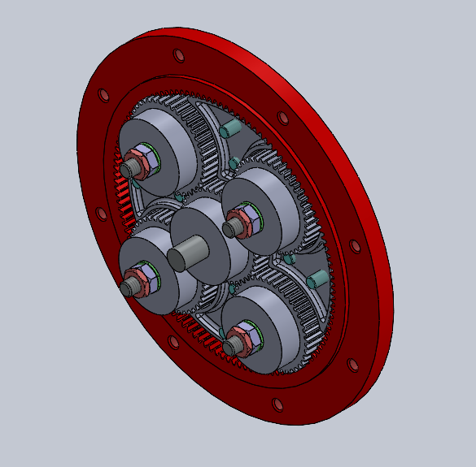
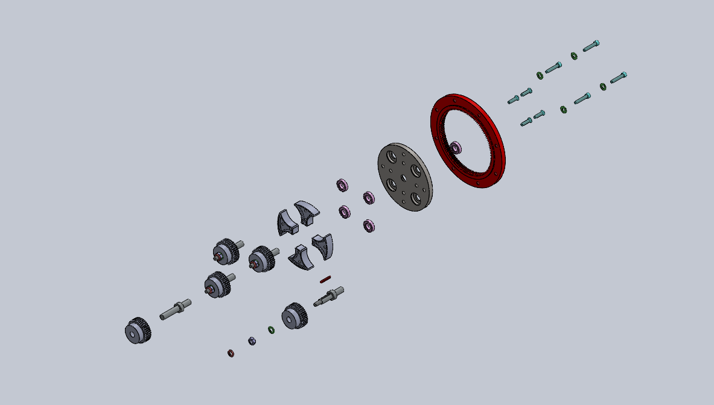
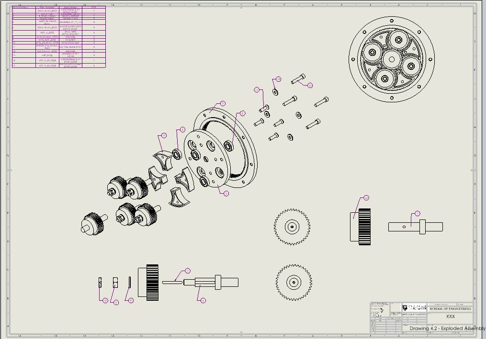
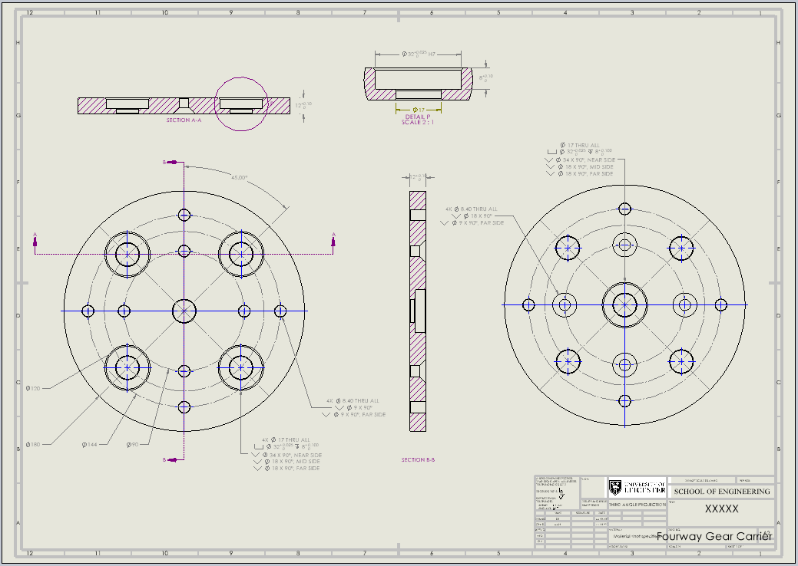

# Epicyclic Planetary Gearbox Assembly

**University coursework | SolidWorks | Mechanical CAD and engineering drawings**

A detailed CAD assembly of an epicyclic (planetary) gearbox, designed to represent the arrangement and meshing of a sun gear, **four planet gears**, an internally toothed ring gear, a carrier plate and an output shaft.

## Project overview

The objective was to construct the gearbox from individual SolidWorks components, assemble them using appropriate mates and produce technical documentation to communicate its internal construction. Particular attention was given to **gear alignment, concentricity, constrained motion and assembly structure**.

### Main deliverables

- Modelled sun, planet and ring gear components, carrier plate and shaft
- Constrained SolidWorks assembly with aligned gear geometry
- Section-view checks of the internal assembly
- Exploded CAD assembly showing component relationships
- Exploded engineering assembly drawing with annotations
- Dimensioned carrier-plate engineering drawing

## 1. Planetary gear system

| Component | Function in the mechanism |
| --- | --- |
| **Sun gear** | Central external gear meshing with the planet gears |
| **Four planet gears** | Orbit around the sun gear while meshing with the ring gear |
| **Ring gear** | Internal gear engaging the planets and enclosing the gear train |
| **Carrier plate** | Locates the planet gears and transfers their orbital motion |
| **Shaft** | Connects the assembly to a rotating input or output, according to configuration |

The project represents the geometric relationships within the transmission. The coursework documentation does not establish a measured reduction ratio, torque capacity or mechanical efficiency.

## 2. Parametric modelling and assembly constraints

Each major component was modelled individually and brought into a SolidWorks assembly. The assembly used mates to position the four planet gears at the correct locations around the central sun gear, align their axes and retain the required relationships with the ring gear and carrier.

**Design and verification considerations:**
- Align the central shaft and gear axes concentrically.
- Place the planet gears consistently around the carrier and within the ring gear.
- Restrict unintended translations and rotations with appropriate mates.
- Inspect component clearances and internal alignment using section views.
- Differentiate assembly positioning from actual dynamic gearbox validation.

*Assembly mates can represent an intended mechanism, but a visually correct arrangement alone does not verify tooth contact stress, backlash or operating load.*

## 3. Exploded CAD assembly

The exploded view separates the ring gear, carrier, gears, shaft and hardware to make the full arrangement easier to follow and to show the placement of individual components within the gearbox.

## 4. Exploded engineering drawing

The drawing documents component positions and the relationship between the parts. It includes standard assembly annotations and an exploded view for technical communication.

## 5. Carrier plate manufacturing drawing

The carrier plate was documented separately with multiple views, sections, dimensions and tolerance annotations. It illustrates how the geometry can be described for manufacturing and inspection, although no physical part inspection results are included in the original work.

## 6. Engineering lessons

- **Assembly constraints:** A coherent mechanism requires careful control of relative motion and component positioning.
- **Internal alignment:** Section views are useful for checking geometry that cannot be inspected from an exterior assembly image.
- **Modular modelling:** Separate parts and assembly files make the design easier to inspect and modify.
- **Engineering documentation:** Exploded views and dimensioned drawings communicate mechanical intent more effectively than renders alone.

## Evidence and limitations

**Completed:** CAD component modelling, complete constrained gearbox assembly, section-view checks, exploded model, exploded engineering drawing and carrier-plate drawing.

**Not demonstrated:** Physical fabrication, measured gear ratio, tooth contact loading, stress/fatigue calculations, backlash measurements or experimental gearbox performance. This is a **mechanical CAD coursework project**, not a tested transmission.

## Related links

- [Portfolio case study](https://farhan10904.github.io/engineering-portfolio/project.html?id=epicyclic)
- [Engineering portfolio homepage](https://farhan10904.github.io/engineering-portfolio/)

**Original SolidWorks files:** If the part (`.SLDPRT`), assembly (`.SLDASM`) and drawing (`.SLDDRW`) files are still available, they can be added later under `CAD/` and `Drawings/`. The image archive is already included in this repository package.
